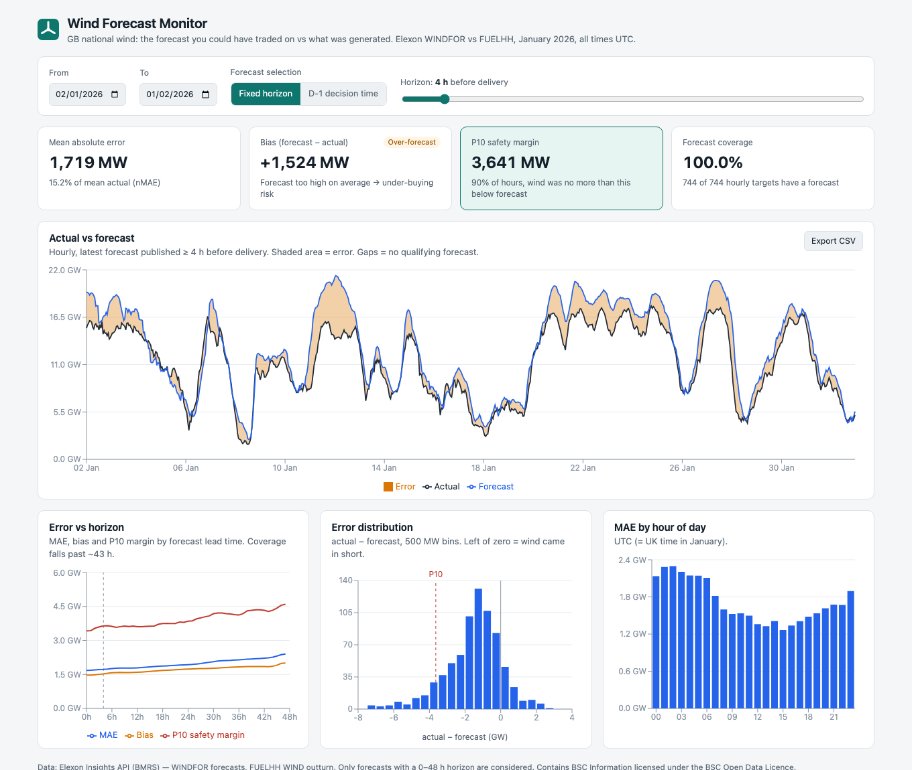

# UK Wind Forecast Monitor

A pilot dashboard for a GB day-ahead power trading desk. It shows **the wind forecast that was actually available when a purchase decision had to be made**, compares it with metered wind generation, and turns the errors into a sizing rule: *"to be 90% safe, assume wind comes in X MW below forecast."*

National-level wind only. Data comes from Elexon (WINDFOR forecasts, FUELHH outturn) for delivery from 2 Jan to 1 Feb 2026, which covers purchase decisions made in January 2026.

**Live app:** LIVE_URL_HERE



<!-- GIF placeholder: docs/screenshots/demo.gif (slider + mode toggle walkthrough) -->

---

## Contents

- [Key findings (January 2026)](#key-findings-january-2026)
- [How to run](#how-to-run)
- [Forecast selection logic and assumptions](#forecast-selection-logic-and-assumptions)
- [Metrics](#metrics)
- [API](#api)
- [Directory guide](#directory-guide)
- [Architecture](#architecture)
- [Testing and CI](#testing-and-ci)
- [Deploying to Vercel](#deploying-to-vercel)
- [Limitations and future work](#limitations-and-future-work)
- [AI tools disclosure](#ai-tools-disclosure)

---

## Key findings (January 2026)

Computed by the app over the 744 hourly delivery times from 2 Jan 00:00 to 1 Feb 23:00 UTC. Reproduce them with `notebooks/analysis.ipynb` or the API.

| Selection | MAE | nMAE | Bias (f − a) | P10 of (a − f) | P50 | P90 | Coverage |
|---|---|---|---|---|---|---|---|
| 4 h ahead | 1,719 MW | 15.2% | **+1,524 MW** | **−3,641 MW** | −1,332 | +188 | 100% |
| D-1 09:00 decision | 2,022 MW | 17.9% | **+1,746 MW** | **−4,154 MW** | −1,582 | +426 | 100% |

Mean actual wind over the period was 11,286 MW.

1. **Safety margin.** At the D-1 09:00 decision time (which always uses the 07:30 D-1 run, 16.5–39.5 h ahead), wind came in **no more than about 4.15 GW below forecast in 90% of hours**. At 4 h ahead the figure is about 3.6 GW.
2. **The forecast is biased high.** It exceeded outturn in 85–87% of hours, by about 1.5–1.7 GW on average. The bias grows with forecast level: +2.7 GW when the forecast is above 15 GW, against +0.6 GW below 10 GW. It also grows overnight: +2.1 to +2.3 GW at 00–06 UTC, against about +0.9 GW at 12–13 UTC.
   That pattern fits curtailment and constraint actions at times of high wind and low demand, or a difference in which wind farms each dataset covers. It doesn't look like random weather error. **Most of the safety margin is this steady offset.** Removing the in-sample mean bias shrinks the D-1 P10 from −4.15 GW to about −2.4 GW (see the notebook; in-sample, so optimistic).
3. **Error grows slowly with lead time.** MAE goes from 1.68 GW at 0 h to 1.93 GW at 24 h and 2.23 GW at 43 h. P10 goes from −3.4 GW to −4.3 GW.
4. **Coverage beyond 43 h.** Forecast runs publish at :30, every 2–4 h, so under the strict "≤ 48 h horizon" rule coverage drops: 96% at 44 h, 62% at 46 h, 29% at 47 h, 0% at 48 h. The app shows these as gaps rather than borrowing an older run.

> Trading takeaway: with the D-1 09:00 forecast, buying cover for about **4.2 GW below the WINDFOR forecast** would have been enough in 9 of 10 hours in January 2026. The cheaper fix is to correct the systematic over-forecast first.

---

## How to run

### Docker (recommended for reviewers)

```bash
docker compose up --build
# Frontend: http://localhost:3000   (nginx; proxies /api to the backend)
# Backend:  http://localhost:8000/api/health   and   /docs (OpenAPI)
```

### Local, without Docker

Requires Python 3.11+ and Node 20+.

```bash
# Backend
cd backend
python3 -m venv .venv && source .venv/bin/activate
pip install -r requirements-dev.txt
uvicorn app.main:app --reload --port 8000

# Frontend (second terminal)
cd frontend
npm ci
npm run dev        # http://localhost:5173, proxies /api to :8000
```

### Refreshing the data

The January 2026 cache in `backend/data/` is committed, so no network access is needed at runtime.

```bash
cd backend && source .venv/bin/activate
python -m scripts.fetch_data   # rewrites data/actuals.json, data/forecasts.json, data/meta.json
```

To skip the cache, delete the files and start the backend with `LIVE_FETCH=true`. It will fetch from Elexon on first request.

### Configuration (environment variables)

| Variable | Default | Purpose |
|---|---|---|
| `DATA_DIR` | `backend/data` | Where the cached JSON lives |
| `LIVE_FETCH` | `false` | Fetch from Elexon if the cache is missing |
| `ELEXON_BASE_URL` | `https://data.elexon.co.uk/bmrs/api/v1` | API base |
| `CORS_ORIGINS` | `http://localhost:5173` | Comma-separated; only needed if the SPA is served from a different origin |
| `VITE_API_BASE` (frontend, build time) | `""` (same origin) | Point the SPA at a remote API |

No secrets are needed: the Elexon Insights API is public.

---

## Forecast selection logic and assumptions

For each **target (delivery) time T** and **horizon H**:

> selected forecast = the WINDFOR row for `startTime = T` with the **latest `publishTime` such that `publishTime ≤ T − H`**, considering only rows whose horizon `T − publishTime` is in **[0, 48] h**. If none qualifies, the value is **missing**. It is never filled from an older run, interpolated or forward-filled.

**Modes**

- **Horizon mode.** H is set by a slider (0–48 h, default 4 h).
- **Decision-time mode.** For delivery day D, use the latest run published at or before a cut-off on D-1, default **09:00 UTC**. For January, UTC is UK local time (GMT), so the cut-off is 09:00 UK time.

**Assumptions** (picked as the most reasonable reading of the brief)

1. **Horizon is measured from `publishTime`,** not from the start of the run or the settlement period. `publishTime ≤ T − H` is inclusive.
2. **The 48 h cap is hard.** A run older than 48 h is excluded even if nothing newer exists. This is why coverage drops beyond about 43 h (see findings).
3. **Rows with a negative horizon are dropped.** Each WINDFOR run includes up to about 10 h of already-elapsed hours, filled in after the fact.
4. **Hourly/half-hourly alignment: exact timestamp match.** WINDFOR is hourly and FUELHH is half-hourly. Targets are the **on-the-hour** times only, and the :30 actuals are not used.
   Coverage is therefore measured over hourly targets (744 in the full range), not half-hours. Alternatives, like averaging the two half-hours or repeating the hourly forecast, are noted as future work.
5. **Decision cut-off uses the UTC calendar day** of the delivery time: D-1 means `date(T) − 1`. The cut-off is inclusive.
   With the default 09:00, the 07:30 D-1 run is always the one selected. The 09:30 run misses the cut-off by 30 minutes, so the setting is sensitive around 09:00–09:30.
6. **Ties** (duplicate `(startTime, publishTime)` rows) are resolved by keeping the last row ingested. None occur in the January data.
7. **Missing actuals** stay as gaps. They count towards coverage (a forecast existed) but are excluded from error metrics. None occur in the January data.
8. **Range clamping.** API requests outside 2026-01-02T00:00Z to 2026-02-01T23:30Z are clamped to that window. An empty range after clamping returns 400.
9. **Everything is UTC,** internally and on the wire. The UI labels all times as UTC.

Data quirks found during API verification are recorded in [`docs/data-notes.md`](docs/data-notes.md).

---

## Metrics

Computed over target times with both a selected forecast and an actual:

| Metric | Definition | Notes |
|---|---|---|
| MAE | mean \|f − a\| | MW |
| RMSE | √mean (f − a)² | Penalises large misses |
| Bias | mean (f − a) | **Positive = over-forecast**, i.e. under-buying risk |
| nMAE | MAE / mean(a) × 100 | Used instead of MAPE, which blows up near zero wind |
| P10 / P50 / P90 | percentiles of **(a − f)** | Linear interpolation (`numpy.percentile`). **P10 is the safety margin**: in 90% of hours, wind was no more than \|P10\| below forecast |
| Coverage | targets with a forecast / all targets × 100 | Hourly targets |
| By horizon | all of the above for H = 0…48 h | Horizon mode only |
| By hour of day | MAE and bias by UTC hour | Uses the current mode |

The error histogram uses (a − f), so the left of zero means wind came in short. The series `error` field is **f − a**, consistent with bias.

---

## API

All endpoints are `GET`, return JSON, and are typed with pydantic. OpenAPI docs are at `/docs`.

| Endpoint | Params | Returns |
|---|---|---|
| `/api/health` | – | status, data window, row counts |
| `/api/series` | `start`, `end`, `mode=horizon&horizon=4` or `mode=decision&cutoff=09:00` | `[{startTime, actual, forecast, error, publishTime, horizonHours}]` |
| `/api/metrics` | same | `{selection, targets, withForecast, paired, coveragePct, meanActual, mae, rmse, bias, nmaePct, p10, p50, p90}` |
| `/api/metrics/by-horizon` | `start`, `end` | `[{horizon, mae, rmse, bias, p10, p90, coveragePct, paired}]` for 0…48 |
| `/api/metrics/by-hour` | same as `/series` | `[{hour, mae, bias, n}]` for 0…23 |

`start` and `end` are ISO 8601; naive values are treated as UTC. Invalid input returns 422 (types or ranges) or 400 (a bad `cutoff`, or an empty range).

---

## Directory guide

```
backend/
  app/main.py              FastAPI app, CORS, error handlers
  app/config.py            Env-var settings and the data window
  app/api/routes.py        Endpoints, param validation, clamping
  app/api/schemas.py       Pydantic response models
  app/core/selection.py    Forecast selection + alignment (pure)
  app/core/metrics.py      Accuracy metrics (pure)
  app/core/data_store.py   Cache load (in-memory) + optional live fetch
  app/ingest/elexon.py     Elexon client: chunking, retries, parsing
  scripts/fetch_data.py    Refresh backend/data/
  data/                    Committed January 2026 cache (JSON, ~1.1 MB)
  tests/                   pytest: selection, metrics, API
  requirements*.txt, pyproject.toml (ruff/black/pytest), Dockerfile
frontend/
  src/components/          Controls, KPI cards, charts, panel states
  src/hooks/               useFetch (abortable), useDebounced
  src/api/client.ts        Typed API client
  src/types/api.ts         Response types
  src/utils/               Formatting, histogram/CSV, URL query state (+ Vitest tests)
  Dockerfile, nginx.conf   Multi-stage build -> nginx, /api proxy
api/index.py               Vercel serverless entry (imports backend/app)
requirements.txt           Lean runtime deps for the Vercel function
vercel.json                Build, function bundle, rewrites
docker-compose.yml         backend :8000 + frontend :3000
docs/data-notes.md         Verified API behaviour and data quirks
docs/architecture.md       Layering and Mermaid diagrams
notebooks/analysis.ipynb   Reproduces findings; bias deep-dive
.github/workflows/ci.yml   Lint + test + build + docker smoke test
```

---

## Architecture

`ingest/` (Elexon client) → `core/` (pure selection and metrics, no I/O) → `api/` (routes and schemas) → React SPA. Data is pre-fetched into committed JSON and held in memory as pandas DataFrames.

See **[docs/architecture.md](docs/architecture.md)** for the Mermaid diagrams and the algorithm.

---

## Testing and CI

```bash
cd backend && pytest -q && ruff check . && black --check .     # 34 tests
cd frontend && npm test && npm run lint && npm run build        # 9 tests
```

- **`tests/test_selection.py`:**
  - latest-before-cutoff selection, and a publish exactly at the cut-off;
  - a tie on publishTime, and the horizon = 0 boundary;
  - negative-horizon rows, and runs published after T − H;
  - no forecast available, and horizons over 48 h (with no fallback to older runs);
  - decision mode across a day boundary, missing actuals, and the half-hour alignment;
  - a slider sweep.
- **`tests/test_metrics.py`:** metric values on hand-computed fixtures, sign conventions, coverage with missing values, empty input, by-hour and by-horizon.
- **`tests/test_api.py`:** response shapes, decision mode, clamping, and 4xx validation.
- **Frontend (Vitest):** histogram binning, CSV export, query params, URL-state parsing.
- **CI** (`.github/workflows/ci.yml`) runs four checks:
  - backend: ruff, black, pytest, and an import check of the Vercel entry;
  - frontend: ESLint, Prettier, Vitest, and the type-check plus build;
  - a `docker compose up --wait` smoke test.

---

## Deploying to Vercel

Vercel **does not use the Dockerfiles**; Docker is only for local and reviewer runs. On Vercel:

- the frontend builds to static files (`frontend/dist`);
- `api/index.py` runs the FastAPI app as a Python serverless function;
- `vercel.json` rewrites `/api/(.*)` to that function, serves the SPA for every other path, and bundles `backend/app/**` and `backend/data/**` into the function (`includeFiles`).

Python dependencies come from the lean root `requirements.txt`, about 136 MB installed, under Vercel's 250 MB limit.

```bash
npm i -g vercel
vercel login
vercel link            # create/link the project; accept the repo root as the root directory
vercel deploy --prod   # prints the production URL -> paste it into LIVE_URL_HERE above
```

Or import the GitHub repo in the Vercel dashboard. `vercel.json` already sets the build, install and output, so leave the framework preset as **Other**.

**Disable Deployment Protection** so the URL works in an incognito window: Project → Settings → Deployment Protection → set Vercel Authentication to **Disabled**.

After deploying, check `https://<url>/api/health` and `https://<url>/?mode=decision`.

---

## Limitations and future work

- **Bias, not just noise.** The forecast vs FUELHH gap is mostly systematic (see findings). Next steps:
  - reconcile which wind farms each dataset covers, for example embedded and curtailed output;
  - offer a bias-corrected view using a rolling, out-of-sample correction.
- **Alignment.** Only on-the-hour targets are compared. Averaging each pair of half-hours to an hourly actual would use all the data.
- **Solar and regional.** Add solar (Elexon/NESO embedded solar forecasts) and regional or BMU-level wind.
- **Probabilistic forecasts.** Use quantile forecasts where available; estimate margins conditionally (by forecast level, hour or season) instead of one unconditional P10.
- **Alerts.** Notify the desk when the latest run changes materially before the cut-off.
- **Live data.** Scheduled refresh (cron + object storage) instead of a committed one-month cache; extend beyond January 2026.
- **Small sample.** One month (744 hours) of data, and percentiles are in-sample. Don't treat the P10 as a stable, long-run number.

---

## AI tools disclosure

This project was built with the assistance of **Claude Code (Anthropic)**, an AI coding agent working in the terminal. It was used to:

- probe the Elexon API and write `docs/data-notes.md`;
- scaffold and write the backend, frontend, tests, Docker, Vercel and CI configuration;
- compute the metrics from the real data;
- check the UI in headless Chrome;
- draft this README.

The human developer set the requirements, reviewed the work at checkpoints (after API verification and after the core logic and metrics), and is responsible for the final result. All numbers in this README were computed from the cached Elexon data by the code in this repository; none were typed in by hand or estimated.
