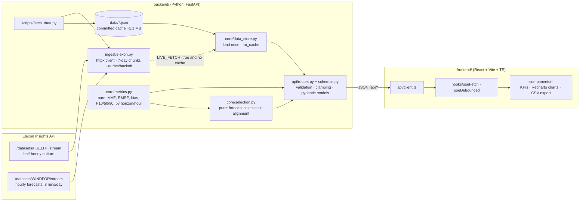
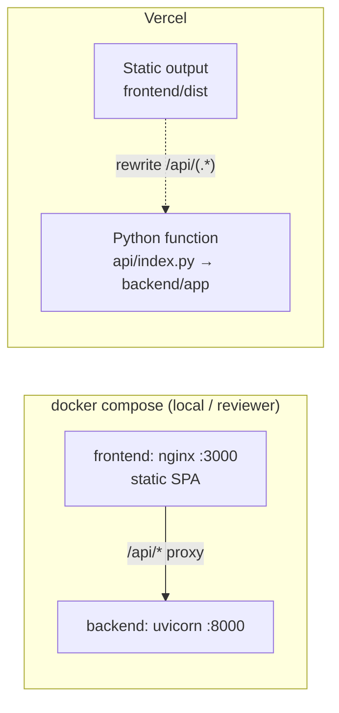

# Architecture

## Layers

| Layer | Responsibility | I/O? |
|---|---|---|
| `ingest/` | Talks to Elexon. It knows the parameter names, chunking, retry policy and response shapes, and returns tidy DataFrames. | Network |
| `scripts/fetch_data.py` | One-off refresh of `backend/data/` (actuals, forecasts and `meta.json`). | Network + disk |
| `core/data_store.py` | Loads the cache into memory once per process. If the cache is missing and `LIVE_FETCH=true`, it fetches live instead. | Disk |
| `core/selection.py` | Builds a cut-off per target, picks the latest eligible forecast, and joins it to actuals. | None |
| `core/metrics.py` | Accuracy metrics over an aligned series. | None |
| `api/` | Parses and validates query params, clamps to the data window, and returns typed JSON. | None |
| `frontend/` | Static SPA. It debounces control changes, aborts stale requests, and keeps the selection in the URL. | HTTP |

## Selection algorithm (vectorised)

1. Drop forecast rows whose horizon `startTime − publishTime` is outside [0, 48] h.
2. Build the target grid: on-the-hour times in [start, end].
3. Compute a cut-off per target.
   - Horizon mode: `T − H`.
   - Decision mode: `date(T) − 1 day + cutoff`.
4. Inner-join targets to forecasts on `startTime`, then keep rows with `publishTime ≤ cutoff`.
5. Stable-sort by `(publishTime, input order)` and take the last row per target. That row is the latest run; on a tie, the last row ingested wins.
6. Reindex back to the full grid, so targets with no qualifying forecast stay `NaN`. They are never filled.
7. Left-join actuals on exact `startTime`.

A full month (744 targets × about 20 candidate runs each) takes a few milliseconds. `by-horizon` repeats this for H = 0…48, about 250 ms, and the API caches it per date range.

## Deployment topologies

Both topologies serve the SPA and the API from the same origin, so the browser never needs CORS. `CORS_ORIGINS` only matters for the Vite dev server.
